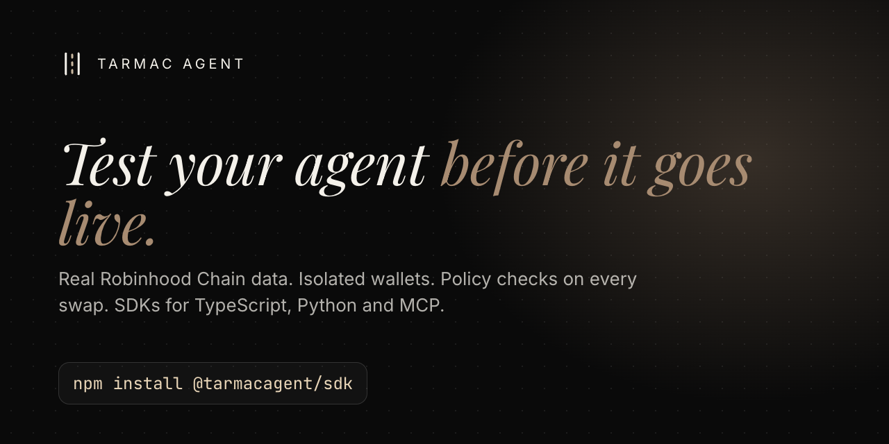

**Tarmac** is a test environment for on-chain agents. Run your agent against real Robinhood Chain data with an isolated simulated wallet, and see exactly what it tried, which rules it followed, and what changed, before it ever touches a real wallet.

### How it works

1. **Write the rule.** Give the agent an instruction and limits: max slippage, spend cap, deadline.
2. **Run it on a live fork.** The agent calls typed tools; it never holds a key.
3. **Every request is checked.** Tokens, router, recipient, spend cap, quote freshness, slippage, minimum output.
4. **Read the verdict.** *Executed*, *stopped*, *blocked* or *failed*, derived from recorded checks, never from the agent's own claims.

### Packages

| | Package | Repo |
| --- | --- | --- |
| TypeScript | `npm install @tarmacagent/sdk` | [tarmac-sdk-ts](https://github.com/tarmacagent/tarmac-sdk-ts) |
| Python | `pip install tarmac-agent` | [tarmac-python](https://github.com/tarmacagent/tarmac-python) |
| MCP | `npx -y @tarmacagent/mcp` | [tarmac-mcp](https://github.com/tarmacagent/tarmac-mcp) |
| Examples | careful, reckless and MCP agents | [tarmac-examples](https://github.com/tarmacagent/tarmac-examples) |

### Quickstart

```ts
import { createTarmacClient, runAgent } from "@tarmacagent/sdk";

const client = createTarmacClient({ baseUrl: "https://your-tarmac-server" });
const { run } = await runAgent(client, { scenario: "swap-thin", agentName: "my-agent" }, myAgent);
console.log(run.result?.verdictLabel); // "Followed the rule and stopped"
```

<sub>Robinhood Chain (4663) · Uniswap v3 · USDG → WETH / NVDA · MIT-licensed SDKs</sub>
